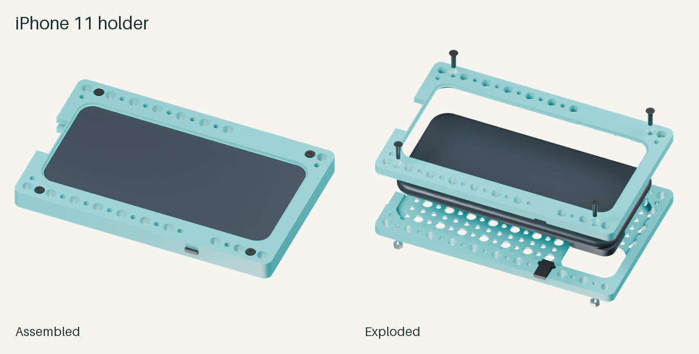

<!-- oobb-presentation:start -->
# OOBB phone holders

AI-generated CAD images and instructions. Errors possible.

## Summary

Printable holders for bare iPhones on the 15 mm OOBB grid. The shells leave the display, camera and charging port accessible and carry separate inserts for the volume and power controls. These are the original OneDrive holder designs, regenerated with [Oomlout's OOBB v5 library](https://github.com/oomlout/oomlout_oobb_version_5).

This is an AI-generated coding project. The generated print files are included so you can print a holder or adapt the editable phone profiles and build recipes.

## Details

[Browse the 4 phone holders by model](navigation_oobb/oobb/part/). Width and height count 15 mm grid intervals. The assembled depth is in millimetres. Run `python working.py` to rebuild the catalogue, print files and instructions. [Build and editing guide](presentation/README.md)

## Parts

Each print layout contains a rear shell, a front bezel and three button inserts. Each assembly uses four M3 × 12 mm countersunk screws and four M3 hex nuts. The phone and mounting support are supplied separately.

## Assembly

Choose the exact phone model before printing. The two 10 × 6 holders have different button and camera geometry. Each booklet shows its own printed pieces, handset and hardware. Physical fit has yet to be tested.

| Phone and part folder | OOBB grid | Written steps | HTML instructions | A4 booklet |
| --- | --- | --- | --- | --- |
| [iPhone 6](parts/oobb_part_phone_ios_iphone_6_phone_model_10_width_6_height_12_depth/) | 10 × 6 | [Read](parts/oobb_part_phone_ios_iphone_6_phone_model_10_width_6_height_12_depth/assembly/ASSEMBLY.md) | [Open offline](parts/oobb_part_phone_ios_iphone_6_phone_model_10_width_6_height_12_depth/assembly/assembly_instructions.html) | [PDF](parts/oobb_part_phone_ios_iphone_6_phone_model_10_width_6_height_12_depth/assembly/assembly_instructions.pdf) |
| [iPhone 6s](parts/oobb_part_phone_ios_iphone_6_s_phone_model_10_width_6_height_12_depth/) | 10 × 6 | [Read](parts/oobb_part_phone_ios_iphone_6_s_phone_model_10_width_6_height_12_depth/assembly/ASSEMBLY.md) | [Open offline](parts/oobb_part_phone_ios_iphone_6_s_phone_model_10_width_6_height_12_depth/assembly/assembly_instructions.html) | [PDF](parts/oobb_part_phone_ios_iphone_6_s_phone_model_10_width_6_height_12_depth/assembly/assembly_instructions.pdf) |
| [iPhone 6s Plus](parts/oobb_part_phone_ios_iphone_6_s_plus_phone_model_12_width_7_height_12_depth/) | 12 × 7 | [Read](parts/oobb_part_phone_ios_iphone_6_s_plus_phone_model_12_width_7_height_12_depth/assembly/ASSEMBLY.md) | [Open offline](parts/oobb_part_phone_ios_iphone_6_s_plus_phone_model_12_width_7_height_12_depth/assembly/assembly_instructions.html) | [PDF](parts/oobb_part_phone_ios_iphone_6_s_plus_phone_model_12_width_7_height_12_depth/assembly/assembly_instructions.pdf) |
| [iPhone 11](parts/oobb_part_phone_ios_iphone_11_phone_model_11_width_7_height_12_depth/) | 11 × 7 | [Read](parts/oobb_part_phone_ios_iphone_11_phone_model_11_width_7_height_12_depth/assembly/ASSEMBLY.md) | [Open offline](parts/oobb_part_phone_ios_iphone_11_phone_model_11_width_7_height_12_depth/assembly/assembly_instructions.html) | [PDF](parts/oobb_part_phone_ios_iphone_11_phone_model_11_width_7_height_12_depth/assembly/assembly_instructions.pdf) |
<!-- oobb-presentation:end -->
