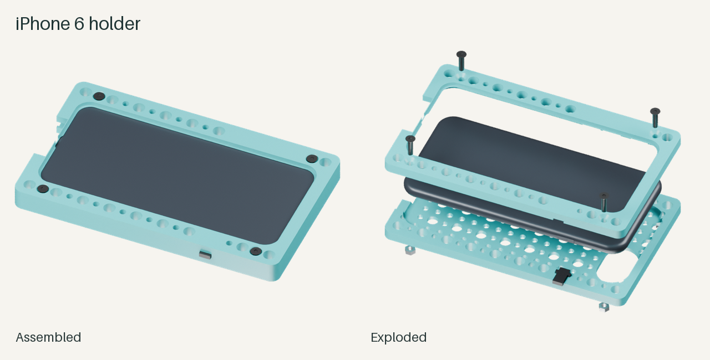

<!-- oobb-presentation:start -->
# iPhone 6 holder

AI-generated CAD images and instructions. Errors possible.

## Summary

A two-piece OOBB holder for the bare iPhone 6. The rear shell has a camera opening and captive nut pockets. The front bezel retains the phone and the three sliding button inserts.



## Details

| OOBB grid | Assembled depth | Full OOMP ID |
| --- | --- | --- |
| 10 × 6 | 12 mm | `oobb_part_phone_ios_iphone_6_phone_model_10_width_6_height_12_depth` |


[Canonical part folder](../../../../../../../parts/oobb_part_phone_ios_iphone_6_phone_model_10_width_6_height_12_depth/) · [Complete OOMP metadata](../../../../../../../parts/oobb_part_phone_ios_iphone_6_phone_model_10_width_6_height_12_depth/working.yaml) · [Browse models](../../../../)

<details>
<summary>Full part metadata</summary>

```yaml
assembly_details:
  inventory:
    front:
      name: Front bezel
      quantity: 1
    nut:
      catalogue: oomlout_oomp_version_1_messy
      id: hardware_nut_m3
      name: M3 hex nut
      quantity: 4
    phone:
      catalogue: oomp_phone_version_5
      id: phone_ios_iphone_6_64_gb_gold_color_apple_a1586
      name: iPhone 6
      quantity: 1
    power:
      name: Power insert
      quantity: 1
    rear:
      name: Rear shell
      quantity: 1
    screw:
      catalogue: oomp_hardware_screw_version_5
      id: hardware_screw_countersunk_hex_head_black_m3_diameter_12_mm_length
      name: M3 × 12 countersunk hex screw
      quantity: 4
    volume_down:
      name: Volume down insert
      quantity: 1
    volume_up:
      name: Volume up insert
      quantity: 1
  steps:
  - action: Press four M3 nuts into the hexagonal pockets on the underside of the
      rear shell. Support the nuts as you turn the shell pocket-side up.
    add:
    - rear
    - nut
    eye:
    - 0.35
    - -0.85
    - -0.85
    lift_mm:
      nut: -14
    title: Seat the nuts
  - action: Lay the two volume inserts and the opposing power insert into their side
      channels. Match each retaining flange to its recess and check that the stems
      slide.
    add:
    - volume_up
    - volume_down
    - power
    lift_mm:
      power: 12
      volume_down: 12
      volume_up: 12
    title: Place the inserts
  - action: Lower the bare iPhone 6 screen-up into the rear shell. Align the camera
      with the rear opening and the Lightning port with the end cutout.
    add:
    - phone
    lift_mm:
      phone: 25
    title: Fit the phone
  - action: Lower the front bezel over the screen. Align the four countersinks with
      the rear nuts and keep the button flanges in their channels.
    add:
    - front
    lift_mm:
      front: 28
    title: Close the holder
  - action: Start all four M3 × 12 mm countersunk screws from the front. Tighten evenly
      until the halves meet, then check that each button moves freely and the charging
      plug clears the end wall.
    add:
    - screw
    lift_mm:
      screw: 19
    title: Join the shells
  style:
    border: '000000'
    border_radius_mm: 3
    border_width_pt: 3
    columns: 2
    component_border_width_pt: 1.1
    font_body_pt: 7
    font_code_pt: 6.4
    font_url_prefix_pt: 4.8
    gutter_mm: 4
    margin_mm: 6
    page_mm:
    - 297
    - 210
    quantity_pt: 5.8
    quantity_shift_mm: 1
    rows: 2
    thumbnail_height_mm: 8.5
depth: '12'
display_name: iPhone 6
height: '6'
oobb_details:
  depth: '12'
  height: '6'
  oobb_name: holder_basic
  oobb_type: holder_basic
  phone_model: phone_ios_iphone_6
  prepare_print: true
  run_scad: true
  run_solidcraft: false
  width: '10'
oobb_type: holder_basic
phone_id: phone_ios_iphone_6_64_gb_gold_color_apple_a1586
phone_model: phone_ios_iphone_6
prepare_print: true
taxonomy_1: oobb
taxonomy_10: ''
taxonomy_11: ''
taxonomy_12: ''
taxonomy_13: ''
taxonomy_14: ''
taxonomy_15: ''
taxonomy_2: part
taxonomy_3: phone_ios_iphone_6_phone_model
taxonomy_4: 10_width
taxonomy_5: 6_height
taxonomy_6: 12_depth
taxonomy_7: ''
taxonomy_8: ''
taxonomy_9: ''
width: '10'
name_space: oobb part phone ios iphone 6 phone model 10 width 6 height 12 depth
name_proper: Oobb Part Phone Ios Iphone 6 Phone Model 10 Width 6 Height 12 Depth
name_upper: OOBB PART PHONE IOS IPHONE 6 PHONE MODEL 10 WIDTH 6 HEIGHT 12 DEPTH
url_chat: ''
taxonomy_1_upper: OOBB
taxonomy_1_upper_length_1: O
taxonomy_1_upper_length_2: OO
taxonomy_1_upper_length_3: OOB
taxonomy_1_upper_length_4: OOBB
taxonomy_1_upper_length_5: OOBB
taxonomy_1_length_1: o
taxonomy_1_length_2: oo
taxonomy_1_length_3: oob
taxonomy_1_length_4: oobb
taxonomy_1_length_5: oobb
taxonomy_1_capital: Oobb
taxonomy_1_first_letter: o
taxonomy_1_first_letter_upper: O
taxonomy_2_upper: PART
taxonomy_2_upper_length_1: P
taxonomy_2_upper_length_2: PA
taxonomy_2_upper_length_3: PAR
taxonomy_2_upper_length_4: PART
taxonomy_2_upper_length_5: PART
taxonomy_2_length_1: p
taxonomy_2_length_2: pa
taxonomy_2_length_3: par
taxonomy_2_length_4: part
taxonomy_2_length_5: part
taxonomy_2_capital: Part
taxonomy_2_first_letter: p
taxonomy_2_first_letter_upper: P
taxonomy_3_upper: PHONE_IOS_IPHONE_6_PHONE_MODEL
taxonomy_3_upper_length_1: P
taxonomy_3_upper_length_2: PH
taxonomy_3_upper_length_3: PHO
taxonomy_3_upper_length_4: PHON
taxonomy_3_upper_length_5: PHONE
taxonomy_3_length_1: p
taxonomy_3_length_2: ph
taxonomy_3_length_3: pho
taxonomy_3_length_4: phon
taxonomy_3_length_5: phone
taxonomy_3_capital: Phone Ios Iphone 6 Phone Model
taxonomy_3_first_letter: p
taxonomy_3_first_letter_upper: P
taxonomy_4_upper: 10_WIDTH
taxonomy_4_upper_length_1: '1'
taxonomy_4_upper_length_2: '10'
taxonomy_4_upper_length_3: '10_'
taxonomy_4_upper_length_4: 10_W
taxonomy_4_upper_length_5: 10_WI
taxonomy_4_length_1: '1'
taxonomy_4_length_2: '10'
taxonomy_4_length_3: '10_'
taxonomy_4_length_4: 10_w
taxonomy_4_length_5: 10_wi
taxonomy_4_capital: 10 Width
taxonomy_4_first_letter: '1'
taxonomy_4_first_letter_upper: '1'
taxonomy_5_upper: 6_HEIGHT
taxonomy_5_upper_length_1: '6'
taxonomy_5_upper_length_2: '6_'
taxonomy_5_upper_length_3: 6_H
taxonomy_5_upper_length_4: 6_HE
taxonomy_5_upper_length_5: 6_HEI
taxonomy_5_length_1: '6'
taxonomy_5_length_2: '6_'
taxonomy_5_length_3: 6_h
taxonomy_5_length_4: 6_he
taxonomy_5_length_5: 6_hei
taxonomy_5_capital: 6 Height
taxonomy_5_first_letter: '6'
taxonomy_5_first_letter_upper: '6'
taxonomy_6_upper: 12_DEPTH
taxonomy_6_upper_length_1: '1'
taxonomy_6_upper_length_2: '12'
taxonomy_6_upper_length_3: '12_'
taxonomy_6_upper_length_4: 12_D
taxonomy_6_upper_length_5: 12_DE
taxonomy_6_length_1: '1'
taxonomy_6_length_2: '12'
taxonomy_6_length_3: '12_'
taxonomy_6_length_4: 12_d
taxonomy_6_length_5: 12_de
taxonomy_6_capital: 12 Depth
taxonomy_6_first_letter: '1'
taxonomy_6_first_letter_upper: '1'
id: oobb_part_phone_ios_iphone_6_phone_model_10_width_6_height_12_depth
id_no_class: oobb_part_phone_ios_iphone_6_phone_model_10_width_6_height_12_depth
id_no_type: oobb_part_phone_ios_iphone_6_phone_model_10_width_6_height_12_depth
id_no_size: oobb_part_phone_ios_iphone_6_phone_model_10_width_6_height_12_depth
oomp_key: oomp_oobb_part_phone_ios_iphone_6_phone_model_10_width_6_height_12_depth
link_github: https://github.com/oomlout/oomlout_oomp_version_1_messy/tree/main/parts/oobb_part_phone_ios_iphone_6_phone_model_10_width_6_height_12_depth
link_main: https://github.com/oomlout/oomlout_oomp_version_1_messy/tree/main/parts/oobb_part_phone_ios_iphone_6_phone_model_10_width_6_height_12_depth
link_redirect: https://github.com/oomlout/oomlout_oomp_version_1_messy/tree/main/parts/oobb_part_phone_ios_iphone_6_phone_model_10_width_6_height_12_depth
directory: parts/oobb_part_phone_ios_iphone_6_phone_model_10_width_6_height_12_depth
name: Oobb Part Phone Ios Iphone 6 Phone Model 10 Width 6 Height 12 Depth
name_no_class: Oobb Part Phone Ios Iphone 6 Phone Model 10 Width 6 Height 12 Depth
name_no_type: Oobb Part Phone Ios Iphone 6 Phone Model 10 Width 6 Height 12 Depth
name_no_size: Oobb Part Phone Ios Iphone 6 Phone Model 10 Width 6 Height 12 Depth
md5: ac4f7e6d24d89dbc2a35b8685ad2c23e
md5_5: ac4f7
md5_5_upper: AC4F7
md5_6: ac4f7e
md5_6_upper: AC4F7E
md5_6_alpha: 6q1dq
md5_6_alpha_upper: 6Q1DQ
md5_10: ac4f7e6d24
md5_10_upper: AC4F7E6D24
bip_39_full_array:
- proof
- know
- opera
- endless
- mean
- task
- potato
- require
- hair
- story
- rack
- language
bip_39_full_space: proof know opera endless mean task potato require hair story rack
  language
bip_39_full_no_space: proofknowoperaendlessmeantaskpotatorequirehairstoryracklanguage
bip_39_full_underscore: proof_know_opera_endless_mean_task_potato_require_hair_story_rack_language
bip_39_2_word_array:
- proof
- know
bip_39_2_word_space: proof know
bip_39_2_word_no_space: proofknow
bip_39_2_word_underscore: proof_know
bip_39_3_word_array:
- proof
- know
- opera
bip_39_3_word_space: proof know opera
bip_39_3_word_no_space: proofknowopera
bip_39_3_word_underscore: proof_know_opera
```

</details>

## Parts

Print one copy of the [five-piece layout](../../../../../../../parts/oobb_part_phone_ios_iphone_6_phone_model_10_width_6_height_12_depth/3dpr.stl) at 100%. Use four M3 × 12 mm countersunk screws and four M3 hex nuts. [Assembly inventory](../../../../../../../parts/oobb_part_phone_ios_iphone_6_phone_model_10_width_6_height_12_depth/assembly/parts.csv)

## Assembly

Seat the nuts in the rear shell, place the inserts in their channels and fit the phone screen-up. Lower the bezel and fasten it from the front. Physical fit has yet to be tested.

[Written instructions](../../../../../../../parts/oobb_part_phone_ios_iphone_6_phone_model_10_width_6_height_12_depth/assembly/ASSEMBLY.md) · [Offline HTML viewer](../../../../../../../parts/oobb_part_phone_ios_iphone_6_phone_model_10_width_6_height_12_depth/assembly/assembly_instructions.html) · [A4 booklet](../../../../../../../parts/oobb_part_phone_ios_iphone_6_phone_model_10_width_6_height_12_depth/assembly/assembly_instructions.pdf)
<!-- oobb-presentation:end -->
