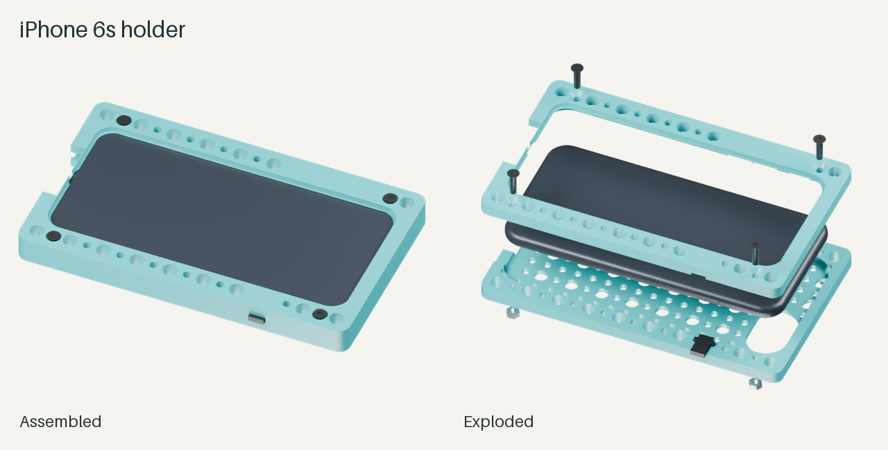

# Assemble the iPhone 6s holder

[Offline illustrated viewer](assembly_instructions.html) · [Printable A4 booklet](assembly_instructions.pdf) · [Parts list](parts.csv)

Print [one layout](../3dpr.stl) at 100% scale. Keep the two volume inserts in their print order. The power insert is the third in the column.

1. Press four M3 nuts into the hexagonal pockets on the underside of the rear shell. Support the nuts as you turn the shell pocket-side up.
2. Lay the two volume inserts and the opposing power insert into their side channels. Match each retaining flange to its recess and check that the stems slide.
3. Lower the bare iPhone 6s screen-up into the rear shell. Align the camera with the rear opening and the Lightning port with the end cutout.
4. Lower the front bezel over the screen. Align the four countersinks with the rear nuts and keep the button flanges in their channels.
5. Start all four M3 × 12 mm countersunk screws from the front. Tighten evenly until the halves meet, then check that each button moves freely and the charging plug clears the end wall.

The four screws join the shells. Choose mounting hardware separately for your support. The handset illustration follows the dimensions of the bare phone. Physical fit has yet to be tested.

AI-generated CAD images and instructions. Errors possible.
